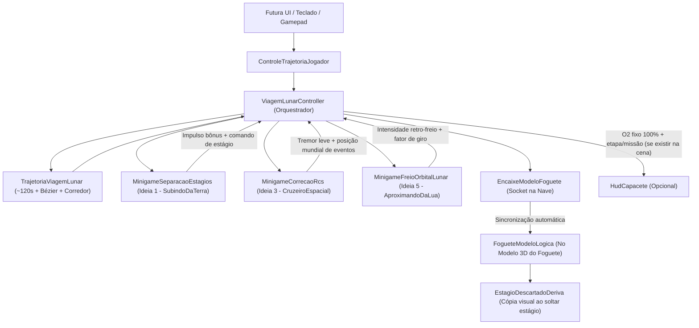

# Arquitetura Lógica — Viagem Espacial e Modelo do Foguete (`Assets/PedroH`)

Este documento descreve onde os scripts criados foram armazenados, como os módulos interagem em tempo de execução e como conectar o futuro modelo 3D do foguete (com estágios destacáveis, propulsores RCS e retro-freio orbital) sem precisar reescrever a lógica de gameplay.

---

## 1. Onde os códigos e arquivos estão armazenados

Todos os arquivos desta funcionalidade ficam isolados dentro de `Assets/PedroH/` para preservar as cenas existentes e as pastas dos demais integrantes do projeto:

| Arquivo | Caminho no Projeto | Tipo / Classe Principal | Responsabilidade |
| :--- | :--- | :--- | :--- |
| **Controlador Central** | `Assets/PedroH/Scripts/ViagemLunarController.cs` | `ViagemLunarController` | Maestro da viagem Terra → Lua (~120s). Liga controles, trajetória, encaixe do foguete, os 3 minigames, oxigênio sempre em 100% e `HudCapacete` opcional. |
| **Entrada Infantil** | `Assets/PedroH/Scripts/ControleTrajetoriaJogador.cs` | `ControleTrajetoriaJogador` | Lê e suaviza comandos de direção (`WASD`/Setas/Gamepad), impulso leve (`Shift`), separação de estágio (`E`/`F`) e retro-freio (`Espaço`/`Ctrl`), além de expor métodos para futura UI. |
| **Rota e Tempo (~2 min)** | `Assets/PedroH/Scripts/TrajetoriaViagemLunar.cs` | `TrajetoriaViagemLunar`, `FaseViagemEspacial` | Calcula a curva Bézier cúbica com decolagem vertical na Terra até a Lua, corredor guiado elíptico e regulador temporal de ~120 segundos. |
| **Ponte de Encaixe** | `Assets/PedroH/Scripts/EncaixeModeloFoguete.cs` | `EncaixeModeloFoguete` | Gerencia os *sockets* (`pontoEncaixeModelo`, cabine, exaustão, câmera), aplica inclinações/vibração/giro de atitude e sincroniza automaticamente o `FogueteModeloLogica`. |
| **Lógica no Modelo 3D** | `Assets/PedroH/Scripts/FogueteModeloLogica.cs` | `FogueteModeloLogica`, `EstagioFogueteConfig`, `BocaisRcsFoguete`, `EstagioDescartadoDeriva` | **Anexado no Prefab/modelo do foguete.** Gerencia estágios destacáveis (com cópia visual em deriva), bocais RCS (ação/reação), luzes/exaustão e giro de retro-freio orbital. |
| **Base dos Minigames** | `Assets/PedroH/Scripts/MinigameViagemBase.cs` | `MinigameViagemBase`, `EstadoMinigameEspacial` | Classe base com máquina de estados, instrução textual para HUD e `ReiniciarMinigame()`. |
| **Ideia 1 — Estágios** | `Assets/PedroH/Scripts/MinigameSeparacaoEstagios.cs` | `MinigameSeparacaoEstagios`, `JanelaSeparacaoEstagio` | Abre janelas na fase `SubindoDaTerra` para descartar estágios com bônus suave de impulso e auto-separação de segurança. |
| **Ideia 3 — Desvios RCS** | `Assets/PedroH/Scripts/MinigameCorrecaoRcs.cs` | `MinigameCorrecaoRcs`, `EventoCorrecaoRcs`, `TipoEventoRcs` | Agenda anéis de alinhamento e desvios de detritos no corredor durante `CruzeiroEspacial`, calculando posição 3D mundial e tremor leve não punitivo. |
| **Ideia 5 — Retro-Freio** | `Assets/PedroH/Scripts/MinigameFreioOrbitalLunar.cs` | `MinigameFreioOrbitalLunar` | Controla a desaceleração na fase `AproximandoDaLua` até a faixa verde de órbita lunar, comandando giro de atitude do foguete e piloto automático auxiliar. |
| **Compatibilidade de Cena** | `Assets/PedroH/Scripts/EstacaoManutencaoNave.cs` | `EstacaoManutencaoNave` | Mantido intacto para preservar referências existentes na cena `Assets/Scenes/NaveEspacial.unity`. |
| **Atalhos no Editor** | `Assets/PedroH/Editor/PedroHMenu.cs` | `PedroHMenu` | Menu superior `pedro-h` no Unity Editor para abrir a cena, selecionar `ViagemLunarController`, ir aos scripts ou abrir este documento. |
| **Documentação** | `Assets/PedroH/Documentacao/ARQUITETURA_VIAGEM_FOGUETE.md` | — | Este guia de arquitetura, interação e conexão do modelo 3D. |

---

## 2. Como os códigos interagem entre si

### 2.1 Visão geral da arquitetura



### 2.2 Fluxo de execução a cada ciclo (`Update` / `PassoDeAtualizacao`)

1. **Inicialização (`Awake` / `Start` / `PrepararNaTerra`)**:
   * `ViagemLunarController.AutoVincularReferencias()` localiza os módulos irmãos/filhos (`TrajetoriaViagemLunar`, `ControleTrajetoriaJogador`, `EncaixeModeloFoguete` e os 3 minigames). Em Play Mode, caso um objeto de cena contenha apenas `ViagemLunarController`, os módulos ausentes são adicionados automaticamente em runtime sem sujar o arquivo `.unity`.
   * Também busca opcionalmente um `HudCapacete` já presente na cena e chama `ManterOxigenioSempreCheio()`, travando `oxigenio` em `100f` (sem consumo ou gerenciamento).
   * `PrepararNaTerra()` coloca a nave no ponto inicial da Terra (`t = 0`), reinicia os 3 minigames e chama `EncaixeModeloFoguete.ReiniciarModeloNaTerra()`.

2. **Leitura de controles (`ControleTrajetoriaJogador.AtualizarLeituraControles`)**:
   * **Direção / Jatos RCS:** `WASD`, Setas, *Left Stick*/D-pad ou `DefinirDirecaoExterna(...)`.
   * **Impulso suave:** `Shift` ou gatilho direito (`+1f`), `Left Ctrl` / `C` (`-1f`), sempre limitado pelo regulador de ~2 minutos.
   * **Separação de Estágio (Ideia 1):** toque em `E`, `F`, ação `Player/Interact`, `Gamepad.buttonNorth` ou `ViagemLunarController.AcionarSeparacaoEstagio()`.
   * **Retro-Freio Orbital (Ideia 5):** segurar `Espaço`, `Left Ctrl`, `C`, `Gamepad.leftTrigger`/`buttonSouth` ou `ViagemLunarController.DefinirRetroFreioPressionado(bool)`.

3. **Avanço da rota Terra → Lua (`TrajetoriaViagemLunar.AvancarTrajetoria`)**:
   * Atualiza o progresso normalizado `Progresso01` (`0..1`) mantendo duração total aproximada de `120s` (`duracaoAlvoSegundos`).
   * Atualiza `DesvioCorredorMetros` dentro do corredor elíptico (`28m` lateral × `16m` vertical), zerado na decolagem (`0..0.06`) e convergindo suavemente para `0` na aproximação final lunar (`0.84..1.0`).
   * Atualiza `FaseAtual` na sequência: `ProntaNaTerra` → `SubindoDaTerra` (`< 0.20`) → `CruzeiroEspacial` (`< 0.84`) → `AproximandoDaLua` (`< 1.0`) → `ChegouNaLua` (`1.0`).

4. **Execução dos 3 minigames por fase**:
   * **Ideia 1 — `MinigameSeparacaoEstagios` (`SubindoDaTerra`)**: abre janelas configuráveis (padrão 2 estágios entre `0.065..0.125` e `0.135..0.195`). Ao separar, chama `EncaixeModeloFoguete.SepararEstagioNoModelo(indice)` → `FogueteModeloLogica.SepararEstagio(indice)` e aplica `ImpulsoBonusAtual01`. Se a janela expirar sem clique, `autoSepararAoExpirarJanela` separa automaticamente com segurança.
   * **Ideia 3 — `MinigameCorrecaoRcs` (`CruzeiroEspacial`)**: avalia sequência de eventos (`AnelDeRota` e `DesvioDeDetrito`) comparando `DesvioCorredorMetros` com a coordenada do evento. Expõe `ObterPosicaoMundoEvento(...)` para futuros visuais 3D. Passar perto de detrito gera apenas tremor leve temporário (`TremorImpactoAtual01`), sem afetar oxigênio nem travar o voo.
   * **Ideia 5 — `MinigameFreioOrbitalLunar` (`AproximandoDaLua`)**: ao entrar em `AproximandoDaLua`, eleva `FatorGiroAtitudeRetro01` (`0 → 1`) e reduz `VelocidadeAproximacao01` (`1.0 → 0.18..0.42`) enquanto o jogador segura o retro-freio. Ao permanecer `2.0s` na faixa verde, marca `OrbitaEstabilizada`. Se não segurar antes de `0.93`, o piloto automático entra gentilmente para garantir chegada lunar segura.

5. **Transmissão para o modelo do foguete (`EncaixeModeloFoguete` → `FogueteModeloLogica`)**:
   * `ViagemLunarController.PassoDeAtualizacao()` consolida `motorPrincipal01`, `retroFreio01`, `fatorGiroRetro01` e `tremorExtra01` e chama `EncaixeModeloFoguete.AplicarEstadoCompletoDaNave(...)`.
   * `EncaixeModeloFoguete` aplica posição/rotação da rota, inclinações visuais nas curvas, vibração de subida e rotação de retro-freio, e atualiza `FogueteModeloLogica.AtualizarSistemasPropulsao(...)` (luzes de motor, luzes/canais RCS opostos por ação e reação e eventos de retro-freio).

6. **Oxigênio e HUD existente**:
   * `ManterOxigenioSempreCheio()` garante `NivelOxigenio == 100f` em todos os momentos. Se `HudCapacete` existir na cena, atualiza o texto de missão com a instrução da fase/minigame atual sem criar nenhuma interface nova.

---

## 3. Como montar quando o modelo 3D do foguete estiver pronto

Toda a lógica já funciona mesmo sem nenhuma malha 3D conectada. Quando o `.fbx` ou `Prefab` do foguete estiver pronto:

### Passo A — Configurar o Prefab / Modelo 3D do Foguete
1. Na raiz do Prefab do foguete, adicione o componente **`FogueteModeloLogica`**.
2. Preencha as referências opcionais que existirem no seu modelo:
   * **`pivotVisualFoguete`**: objeto filho visual que deve inclinar nas curvas e girar no retro-freio (se vazio, usa a raiz do modelo).
   * **`pontoCabine`**, **`pontoExaustaoPrincipal`**, **`pontoExaustaoRetrofreio`**, **`pontoCameraExterna`**: `Transforms` posicionados nos locais correspondentes do foguete.
   * **`estagios`**: para cada item (`Estágio 1`, `Estágio 2`, etc.), arraste o subobjeto 3D do estágio em **`objetoEstagio`**. Durante a viagem, o original é ocultado de forma não destrutiva e uma cópia visual (`EstagioDescartadoDeriva`) se afasta no espaço — ao reiniciar na Terra, o estágio reaparece intacto.
   * **`bocaisRcs`**, **`luzesMotorPrincipal`** e **`luzesRetroFreio`**: arraste os `Transforms`/luzes correspondentes, caso o modelo tenha.
   * **`girarModeloParaRetroFreio`**: deixe marcado (`true`) para o foguete girar (padrão `180°` no eixo `X` local) na manobra de frenagem lunar, ou desmarque caso use bocais frontais de retro-freio sem girar o corpo.
3. *(Opcional)* Conecte sistemas futuros de partículas (VFX) e áudio (SFX) diretamente nos eventos do Inspector de `FogueteModeloLogica` (`aoSepararEstagio`, `aoAcionarRcs`, `aoAlterarRetroFreio`) e nos eventos dos 3 minigames.

### Passo B — Conectar o Foguete à Viagem na Cena
Você pode fazer de duas formas equivalentes:

1. **Diretamente na cena (antes de dar Play):**
   * Coloque o Prefab do foguete como filho de `pontoEncaixeModelo` no objeto que possui `EncaixeModeloFoguete` e `ViagemLunarController` (ex.: `Sistema_Viagem_Lunar` na cena `NaveEspacial.unity`), com posição e rotação locais zeradas.
   * O `EncaixeModeloFoguete.InicializarPontosDeEncaixe()` detectará automaticamente o `FogueteModeloLogica` filho e sincronizará cabine, exaustão e câmera externa caso estejam vazios no encaixe.

2. **Via código em tempo de execução:**
   ```csharp
   // Conecta o prefab (instanciando sob pontoEncaixeModelo) ou um objeto já na cena:
   viagemLunarController.ConectarModeloFoguete(prefabDoFoguete, instanciarSeForPrefab: true);
   ```

### Passo C — Conectar Futura UI (Opcional, Quando For Criada)
* **Botão de Soltar Estágio (Ideia 1):** ligar ao método `viagemLunarController.AcionarSeparacaoEstagio()`, lendo `minigameEstagios.JanelaAtualAtiva` e `ProgressoJanela01`.
* **Indicador de Anéis / Detritos RCS (Ideia 3):** ler `minigameRcs.EventoAtual`, `DistanciaAtualParaAlvoMetros`, `ProgressoAproximacaoEvento01` e `ObterPosicaoMundoEvento(i, trajetoria)`.
* **Barra e Botão Segurável de Retro-Freio (Ideia 5):** ligar eventos de *PointerDown / PointerUp* a `viagemLunarController.DefinirRetroFreioPressionado(true/false)` e ler `minigameFreioOrbital.VelocidadeAproximacao01`, `faixaVerdeMin`, `faixaVerdeMax`, `EstaNaFaixaVerde` e `ProgressoEstabilizacao01`.
