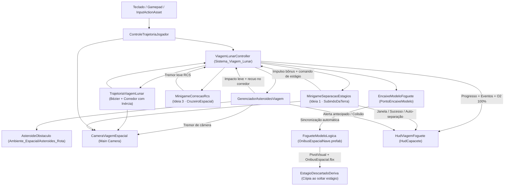

# Arquitetura Lógica — Viagem Espacial Terra → Lua (`Assets/PedroH`)

Este documento descreve a arquitetura atual do sistema de viagem espacial da cena `Assets/Scenes/NaveEspacial.unity`, os scripts responsáveis pela trajetória, controles, câmera, HUD simplificado, desvios de asteroides e separação de estágios, além da conexão do modelo 3D externo do Ônibus Espacial (`Assets/CentroTreinamento/Modelos/OnibusEspacial.fbx`) via prefab encapsulador (`Assets/PedroH/Prefabs/OnibusEspacialNave.prefab`).

> **Escopo desta cena:** A etapa de frenagem orbital (`MinigameFreioOrbitalLunar`) foi removida da cena `NaveEspacial.unity` e **não faz parte deste fluxo** (fica a cargo de outra cena/responsável). O oxigênio permanece fixo em **100%** durante toda a travessia.

Para detalhes específicos sobre a origem do `.fbx` na branch `vinicius`, compatibilidade dos 26 materiais/texturas, mapeamento de nós e guia prático de atualização ou troca de modelo, consulte [`INTEGRACAO_ONIBUS_ESPACIAL.md`](./INTEGRACAO_ONIBUS_ESPACIAL.md).

---

## 1. Mapa de Arquivos e Responsabilidades

Os scripts e ativos de gameplay ficam organizados em `Assets/PedroH/`, integrando o modelo 3D externo hospedado em `Assets/CentroTreinamento/Modelos/`:

| Módulo / Ativo | Caminho no Projeto | Tipo / Classe Principal | Responsabilidade Atual |
| :--- | :--- | :--- | :--- |
| **Controlador Central** | `Assets/PedroH/Scripts/ViagemLunarController.cs` | `ViagemLunarController` | Orquestra a viagem Terra → Lua: lê entradas, avança trajetória com inércia, atualiza minigames ativos (`Estágios` e `RCS`), coordena asteroides, sincroniza `EncaixeModeloFoguete` e mantém oxigênio em `100%`. |
| **Controles de Voo** | `Assets/PedroH/Scripts/ControleTrajetoriaJogador.cs` | `ControleTrajetoriaJogador` | Lê e suaviza comandos de direção (`WASD`/Setas/Gamepad), impulso suave (`Shift`/`Espaço`) e separação de estágio (`E`/`F`), além de expor fachada para UI futura. |
| **Rota e Inércia** | `Assets/PedroH/Scripts/TrajetoriaViagemLunar.cs` | `TrajetoriaViagemLunar`, `FaseViagemEspacial` | Calcula a curva Bézier cúbica da Terra até a Lua (`duracaoAlvoSegundos = 105s` na cena atual), corredor elíptico com aceleração/amortecimento por inércia e orientação estável na rota. |
| **Ponte de Encaixe** | `Assets/PedroH/Scripts/EncaixeModeloFoguete.cs` | `EncaixeModeloFoguete` | Gerencia os sockets (`raizNave`, `pontoEncaixeModelo`, cabine, exaustão, câmera) e `luzesPropulsoresOpcionais`, limpa referências antigas/quebradas em `DesconectarModeloAtual()` e expõe `SincronizarFogueteModeloLogica()` público. |
| **Lógica no Prefab da Nave** | `Assets/PedroH/Scripts/FogueteModeloLogica.cs` | `FogueteModeloLogica`, `EstagioFogueteConfig`, `BocaisRcsFoguete`, `EstagioDescartadoDeriva` | Anexado na raiz de `OnibusEspacialNave.prefab`. Controla estágios com irmãos LOD (`objetosAdicionaisEstagio`), descarte no referencial da nave (`usarEspacoDaNaveParaDescarte`), pivô no centro visual (`CalcularCentroVisualMundo`), luzes do motor principal e canais RCS (ação/reação). |
| **Base de Minigames** | `Assets/PedroH/Scripts/MinigameViagemBase.cs` | `MinigameViagemBase`, `EstadoMinigameEspacial` | Classe base com máquina de estados (`Aguardando`, `Ativo`, `Concluido`, `EncerradoPorSeguranca`), instrução textual e `ReiniciarMinigame()`. |
| **Ideia 1 — Estágios** | `Assets/PedroH/Scripts/MinigameSeparacaoEstagios.cs` | `MinigameSeparacaoEstagios`, `JanelaSeparacaoEstagio` | Abre janelas de separação durante `SubindoDaTerra` (`0.065..0.125` e `0.135..0.195`), aplica impulso bônus manual e executa auto-separação segura se a janela expirar. |
| **Ideia 3 — Desvios RCS** | `Assets/PedroH/Scripts/MinigameCorrecaoRcs.cs` | `MinigameCorrecaoRcs`, `EventoCorrecaoRcs`, `TipoEventoRcs` | Avalia eventos de rota (`AnelDeRota` e `DesvioDeDetrito`) durante `CruzeiroEspacial` usando o desvio no corredor, com tremor leve não punitivo. |
| **Asteroide Individual** | `Assets/PedroH/Scripts/AsteroideObstaculo.cs` | `AsteroideObstaculo` | Representa um asteroide na rota (`progressoNaRota`, `coordenadaCorredor`, `raioColisaoMetros`), gira continuamente e aplica deriva/rotação pós-esbarrão com cooldown. |
| **Gerenciador de Asteroides** | `Assets/PedroH/Scripts/GerenciadorAsteroidesViagem.cs` | `GerenciadorAsteroidesViagem` | Monitora `Ambiente_Espacial/Asteroides_Rota`, emite alerta antecipado acompanhando a curvatura da Bézier, calcula `DirecaoSugeridaDesvio` e trata colisões justas sem travar a viagem. |
| **HUD Simplificado** | `Assets/PedroH/Scripts/HudViagemFoguete.cs` | `HudViagemFoguete` | Simplifica o `HudCapacete` ocultando painéis extras, exibe O2 fixo em `100%`, progresso até a Lua, resumo de controles e avisos centrais temporários (desacoplamento, asteroide, impacto, chegada). |
| **Câmera de Voo** | `Assets/PedroH/Scripts/CameraViagemEspacial.cs` | `CameraViagemEspacial` | Acompanha a nave em `Sistema_Viagem_Lunar/Main Camera` com deslocamento por inércia, recuo e abertura de FOV no impulso, roll suave nas curvas e tremor de impacto. |
| **Compatibilidade de Cena** | `Assets/PedroH/Scripts/EstacaoManutencaoNave.cs` | `EstacaoManutencaoNave` | Mantido para preservar referências de estações de exploração (`AlvoExploracao`) existentes na cena `NaveEspacial.unity`. |
| **Atalhos de Editor** | `Assets/PedroH/Editor/PedroHMenu.cs` | `PedroHMenu` | Menu superior `pedro-h` no Unity Editor para abrir `NaveEspacial.unity`, selecionar `ViagemLunarController`, abrir `Assets/PedroH/Scripts` e abrir este `.md`. |
| **Prefab da Nave** | `Assets/PedroH/Prefabs/OnibusEspacialNave.prefab` | Prefab (wrapper com `FogueteModeloLogica`) | Encapsula `OnibusEspacial.fbx` em `PivotVisual` com rotação/escala/posição corrigidas para `+Z` frente / `+Y` cima, `Tripulante_Astronauta` + `LuzCabine`, exaustão/RCS, `PontoCameraExterna` e os 2 estágios configurados (`FoguetePlaceholder.prefab` permanece como referência anterior). |
| **Modelo 3D Externo** | `Assets/CentroTreinamento/Modelos/OnibusEspacial.fbx` | Asset FBX (branch `vinicius`) | Malha externa do Ônibus Espacial (`Onibus_Orbitador`, `Onibus_Orbitador_Transp`, `Onibus_Interior`, `Onibus_Boosters`, `Onibus_TanqueExterno` e LODs `_L1`/`_L2`). |
| **Documentação Técnica** | `Assets/PedroH/Documentacao/ARQUITETURA_VIAGEM_FOGUETE.md`<br>`Assets/PedroH/Documentacao/INTEGRACAO_ONIBUS_ESPACIAL.md` | Documentação Markdown | Arquitetura geral do sistema e guia específico de integração/atualização do `OnibusEspacial.fbx`. |

> **Nota sobre arquivo legado fora do fluxo:** O script `Assets/PedroH/Scripts/MinigameFreioOrbitalLunar.cs` não é referenciado por `ViagemLunarController`, `ControleTrajetoriaJogador`, `HudViagemFoguete` nem pela cena `NaveEspacial.unity`. A etapa de frenagem orbital foi retirada deste fluxo de cena.

---

## 2. Arquitetura e Interação Entre os Módulos

### 2.1 Diagrama de Dependências em Runtime



---

## 3. Fluxo de Execução por Ciclo

### 3.1 Inicialização (`Awake` / `Start` / `PrepararNaTerra`)
1. `ViagemLunarController.AutoVincularReferencias()` resolve os componentes locais ou filhos (`TrajetoriaViagemLunar`, `ControleTrajetoriaJogador`, `EncaixeModeloFoguete`, `MinigameSeparacaoEstagios`, `MinigameCorrecaoRcs`, `GerenciadorAsteroidesViagem`, `CameraViagemEspacial`) e chama `EncaixeModeloFoguete.InicializarPontosDeEncaixe()`, que executa `SincronizarFogueteModeloLogica()` para localizar `OnibusEspacialNave` dentro de `PontoEncaixeModelo`, capturar os estados iniciais de estágios/LODs e sincronizar `pontoCabineOpcional`, `pontoExaustaoPropulsorOpcional`, `pontoCameraExternaOpcional` e `luzesPropulsoresOpcionais`.
2. `ManterOxigenioSempreCheio()` mantém `NivelOxigenio == 100f` (e garante `oxigenio == 100f` caso `hudCapaceteExistente` esteja vinculado com `sincronizarHudExistente = true`).
3. `PrepararNaTerra()` zera controles, restaura o modelo conectado (`ReiniciarModeloNaTerra()`), reinicia `minigameEstagios`, `minigameRcs` e `gerenciadorAsteroides`, posiciona a nave em `t = 0` (`Planeta_Terra` + `offsetPartidaTerra`) e chama `CameraViagemEspacial.ResetarImediatamente()`.
4. Com `iniciarAutomaticamenteAoIniciar = true`, `Start()` chama `IniciarViagem()`, transitando de `ProntaNaTerra` para `SubindoDaTerra`.

### 3.2 Leitura de Controles (`ControleTrajetoriaJogador.AtualizarLeituraControles`)
Os comandos lidos com suavização exponencial (`suavizacaoEntrada = 11f`, `suavizacaoRetornoEntrada = 8.5f`, `zonaMorta = 0.08f`) são:
* **Navegação lateral e vertical (RCS):** `WASD`, Setas, *Left Stick* / D-pad, ação `Player/Move` ou `DefinirDirecaoExterna(Vector2)`. Com `direcaoVerticalIntuitiva = true`, `W` / Seta para cima sobe a nave.
* **Impulso suave:** `Shift` (Esquerdo/Direito), `Espaço`, ações `Player/Sprint` / `Player/Jump`, `Gamepad.rightTrigger` / `buttonSouth` ou `DefinirImpulsoExterno(bool)`.
* **Desacoplamento de estágio (Ideia 1):** toque em `E`, `F`, ação `Player/Interact`, `Gamepad.buttonNorth` ou `SolicitarSeparacaoExterna()` / `ViagemLunarController.AcionarSeparacaoEstagio()`.
* **Texto-resumo exposto para HUD (`TextoResumoControles`):** `"WASD / Setas: Navegar   •   Shift / Espaço: Impulso   •   E: Desacoplar estágio"`.

### 3.3 Avanço da Trajetória e Inércia (`TrajetoriaViagemLunar.AvancarTrajetoria`)
* **Curva Bézier cúbica (`pontoP0` → `pontoP3`):** parte de `pontoPartidaTerra` (`Planeta_Terra`) seguindo a vertical de `referenciaVerticalSubida` (`PontoReferenciaSubidaTerra`, `proporcaoAlturaSubidaInicial = 0.30`) e desenha arco orbital suave até `pontoChegadaLua` (`Lua_Orbital_Destino`, `proporcaoCurvaAproximacaoLua = 0.25`).
* **Regulador temporal:** usa `duracaoAlvoSegundos = 105f` (~1m45s em ritmo nominal; `multiplicadorMinimoRitmo = 0.85f`, `multiplicadorMaximoRitmo = 1.55f`, rampa longitudinal `velocidadeAceleracaoImpulso = 2.6f` e `velocidadeDesaceleracaoImpulso = 1.3f`).
* **Corredor elíptico com inércia:** deslocamento livre em `DesvioCorredorMetros` dentro da elipse `raioCorredorLateral = 26m` × `raioCorredorVertical = 14m`, controlado por aceleração (`aceleracaoLateral = 54`, `aceleracaoVertical = 38`), limites de velocidade (`28 m/s` lateral × `18 m/s` vertical) e arrasto exponencial suave (`amortecimentoSemEntrada = 2.4`, `amortecimentoComEntrada = 1.5`, `autoCentralizarSemEntrada = false`).
* **Envelope do corredor:** bloqueado na saída imediata da Terra (`inicioControleAposDecolagem = 0.03`) e convergindo suavemente para o centro a partir de `inicioAlinhamentoLunar = 0.85` até `1.0`.
* **Orientação estável (`CalcularOrientacaoEstavelNaTrajetoria`):** combina a tangente da rota com o vetor real de velocidade no corredor para que o nariz do Ônibus Espacial acompanhe a direção efetiva de voo sem inversões de eixo.
* **Sequência de fases (`FaseViagemEspacial`):**
  * `ProntaNaTerra` (`t = 0`)
  * `SubindoDaTerra` (`0 < t < 0.20`)
  * `CruzeiroEspacial` (`0.20 <= t < 0.85`)
  * `AproximandoDaLua` (`0.85 <= t < 1.0`) — alinhamento final suave até a Lua (sem manobra de frenagem orbital)
  * `ChegouNaLua` (`t = 1.0`) — dispara `aoChegarNaLua` e conclui a viagem (`ConcluirViagemNaLua()`).

### 3.4 Separação de Estágios e Eventos RCS
* **Ideia 1 — `MinigameSeparacaoEstagios` (`SubindoDaTerra`):**
  * Abre 2 janelas configuráveis durante a subida (`0.065..0.125` e `0.135..0.195`).
  * Ao acionar `E`/`F` (ou `AcionarSeparacaoEstagio()`), chama `EncaixeModeloFoguete.SepararEstagioNoModelo(indice)` → `FogueteModeloLogica.SepararEstagio(indice)` e concede bônus suave de impulso (`intensidadeImpulsoBonus = 0.45f` por `2.4s`).
  * Se a janela expirar sem comando do jogador, `autoSepararAoExpirarJanela = true` executa o descarte seguro automaticamente.
  * **Mapeamento na cena `NaveEspacial.unity` e no `OnibusEspacialNave.prefab`:**
    * **Estágio 1 (índice `0` — `"Estágio 1 — Boosters Laterais (SRB)"`):** `Onibus_Boosters` (os 2 foguetes auxiliares sólidos SRB) + irmãos LOD `_L1`/`_L2` em `objetosAdicionaisEstagio`, descarte em `(0, -0.55, -1)` a `7.5 m/s` (`velocidadeGiroDescarte = 20`).
    * **Estágio 2 (índice `1` — `"Estágio 2 — Tanque Externo"`):** `Onibus_TanqueExterno` (o tanque externo laranja) + irmãos LOD `_L1`/`_L2` em `objetosAdicionaisEstagio`, descarte em `(0, -0.80, -1)` a `6.5 m/s` (`velocidadeGiroDescarte = 16`).
    * **Pós-separação:** o Orbitador (`Onibus_Orbitador` + vidro `Onibus_Orbitador_Transp` + `Onibus_Interior`) prossegue até a Lua.
* **Ideia 3 — `MinigameCorrecaoRcs` (`CruzeiroEspacial`):**
  * Avalia 4 eventos padrão entre `0.24` e `0.77` (`AnelDeRota` e `DesvioDeDetrito`) comparando `DesvioCorredorMetros` com `coordenadaCorredor` apenas na banda de cruzamento (`margemCruzamentoAntesDoAlvo = 0.02`), aplicando tremor leve não punitivo (`duracaoTremorImpactoLeve = 0.85s`) caso um detrito não seja evitado.

### 3.5 Asteroides na Rota (`AsteroideObstaculo` + `GerenciadorAsteroidesViagem`)
* `GerenciadorAsteroidesViagem` localiza os asteroides sob `Ambiente_Espacial/Asteroides_Rota` (na cena `NaveEspacial.unity`, `Asteroide_Rota_01` a `Asteroide_Rota_10` distribuídos entre `progressoNaRota = 0.27` e `0.81`).
* **Alerta antecipado com curvatura real:** para asteroides à frente (`ast.progressoNaRota > progresso01` e `projFrente <= distanciaAntecedenciaAlerta`, com padrão `95f` no script / `80f` na cena e `progresso01 < 0.88f`), avalia a seção futura da Bézier no `progressoNaRota` do asteroide (`AvaliarPosicaoNaCurvaComDesvio` + `CalcularOrientacaoEstavelNaTrajetoria`), evitando falsos positivos causados pela curvatura da trajetória. Se a distância lateral estiver dentro de `raioSoma + margemLateralAlertaMetros` (`3.2m`), calcula `DirecaoSugeridaDesvio` e dispara `aoDetectarAsteroideNaRota`.
* **Colisão justa e não punitiva:** usa distância esférica `raioNaveMetros (2.2f no script e na cena NaveEspacial.unity) + ast.raioColisaoMetros` com cooldown (`2.2s` por asteroide). No impacto, empurra o asteroide (`AsteroideObstaculo.RegistrarImpacto`), aplica recuo suave na velocidade do corredor (`AplicarImpulsoExternoCorredor` com `impulsoDesvioPosImpacto = 16f`), aciona tremor leve na nave (`NotificarImpactoAsteroideLeve()`) e na câmera (`cameraViagem.AcionarTremorImpacto(0.8f)`), e dispara `aoColidirComAsteroide` sem zerar progresso nem consumir oxigênio.

### 3.6 Câmera de Acompanhamento (`CameraViagemEspacial`)
* Componente acoplado em `Sistema_Viagem_Lunar/Main Camera`, atualizado em `LateUpdate`.
* Mantém enquadramento centralizado na cena `NaveEspacial.unity` (`posicaoLocalBase = (0, 4.15, -15.20)`, `alvoLocalBase = (0, 0.65, 0.52)`, `fovBase = 60°`, alinhado ao `PontoCameraExterna` do prefab; fallback padrão no script: `(0, 4.0, -14.5)` e `(0, 0, 0.515)`).
* Traduz velocidade no corredor e energia de impulso em atraso lateral/vertical (`deslocamentoInerciaLateral = 1.15`, `deslocamentoInerciaVertical = 0.75`), recuo longitudinal (`recuoZImpulso = 1.35`), abertura de FOV (`incrementoFovImpulso = 6.5`), inclinação leve de horizonte (`rollMaximoCamera = 4.5°`) e tremor de impacto.

### 3.7 HUD Simplificado (`HudViagemFoguete`)
* Opera sobre o `HudCapacete` da cena `NaveEspacial.unity`, ocultando elementos não utilizados nesta fase (`elementosOcultarNaFase`) e mantendo oxigênio fixo em `100%` (`TemaCapacete.Ciano`), barra/percentual de progresso até a Lua e `dicaControlesTexto`.
* Gerencia o `painelAvisoCentral` (fade via `CanvasGroup` + pulso suave de escala) reagindo aos eventos de `ViagemLunarController`, `MinigameSeparacaoEstagios` e `GerenciadorAsteroidesViagem`:
  * **Janela de estágio (`aoLiberarJanelaSeparacao`):** `"HORA DE DESACOPLAR!"` (`duracaoAvisoDesacoplar = 5.5s`).
  * **Desacoplamento manual (`aoSepararEstagioComSucesso`):** `"ESTÁGIO DESACOPLADO!"` (`duracaoConfirmacaoDesacoplado = 1.25s`).
  * **Asteroide à frente (`aoDetectarAsteroideNaRota`):** `"ASTEROIDE À FRENTE!"` com subtítulo dinâmico atualizado pela `DirecaoSugeridaDesvio` (`duracaoAlertaAsteroide = 6.0s`).
  * **Esbarrão leve (`aoColidirComAsteroide`):** `"ESBARRÃO EM ASTEROIDE!"` (`duracaoImpactoAsteroide = 1.6s`).
  * **Chegada à Lua (`aoChegarNaLua`):** `"CHEGAMOS À LUA!"` (`4.5s`).

### 3.8 Transmissão ao Modelo 3D (`EncaixeModeloFoguete` → `FogueteModeloLogica`)
* `ViagemLunarController.PassoDeAtualizacao()` calcula `motorPrincipal01` (`0.90..1.0` na subida, `0.45..0.90` no cruzeiro, `0.45..0.70` na aproximação final) e `tremorExtra01` (`Mathf.Max(tremorRcs, tremorImpactoAsteroide01)`), passando `0f, 0f` para retro-freio e giro de retro-atitude.
* `EncaixeModeloFoguete.AplicarEstadoCompletoDaNave(...)` combina entrada do jogador e velocidade normalizada no corredor (`entradaControleSuave * 0.55f + velocidadeCorredorNormalizada * 0.65f`) para aplicar inclinação suave (`16°` rolagem, `12°` arfagem, `8°` guinada) e vibração no `pontoEncaixeModelo` (ou no `pivotVisualFoguete`), mantendo a raiz `Sistema_Viagem_Lunar` estável para a câmera.
* `FogueteModeloLogica.AtualizarSistemasPropulsao(...)` atualiza `luzesMotorPrincipal` (`intensidadeMaximaMotorPrincipal = 6.5` no prefab) e os 4 canais RCS (`intensidadeMaximaLuz = 4.5` no prefab) com polaridade ação/reação (virar à direita aciona `luzEsquerda`, subir aciona `luzBaixo`, etc.).
* Ao separar um estágio, `FogueteModeloLogica.ExecutarDesacoplamentoVisualSeguro(...)` calcula o centro visual real da peça via `CalcularCentroVisualMundo(...)` (evitando giro excêntrico em nós FBX cujo pivô fica distante da malha), oculta `objetoEstagio` e seus irmãos LOD em `objetosAdicionaisEstagio`, cria um pivô `_Separado` no centro visual orientado por `ObterReferencialDescarte` (`usarEspacoDaNaveParaDescarte = true`), instancia `_Visual` preservando `t.lossyScale`, remove `Camera`/`AudioListener`/`FogueteModeloLogica`/`Collider`/`Light` via `LimparComponentesBloqueantesDaCopia` e anexa `EstagioDescartadoDeriva` (`tempoVidaEstagioSolto = 8s`). Ao reiniciar na Terra, `ReiniciarEstadoModelo()` destrói clones restantes e chama `RestaurarEstadosIniciais()`, restaurando `objetoEstagio` e `objetosAdicionaisEstagio` segundo o estado inicial capturado por `CapturarEstadosIniciaisSeNecessario()` (mantendo `_L1`/`_L2` desativados).

---

## 4. Hierarquia Atual da Nave Integrada (`OnibusEspacialNave.prefab`)

Na cena `Assets/Scenes/NaveEspacial.unity`, `EncaixeModeloFoguete.modeloFogueteAtual` aponta para `OnibusEspacialNave` dentro de `Sistema_Viagem_Lunar/PontoEncaixeModelo`:

```text
Sistema_Viagem_Lunar (ViagemLunarController, TrajetoriaViagemLunar, ControleTrajetoriaJogador,
│                     EncaixeModeloFoguete, MinigameSeparacaoEstagios, MinigameCorrecaoRcs,
│                     GerenciadorAsteroidesViagem)
├── PontoEncaixeModelo (Transform alvo de EncaixeModeloFoguete)
│   └── OnibusEspacialNave (Assets/PedroH/Prefabs/OnibusEspacialNave.prefab · FogueteModeloLogica)
│       ├── PivotVisual (pivotVisualFoguete)
│       │   ├── OnibusEspacial (instância de Assets/CentroTreinamento/Modelos/OnibusEspacial.fbx)
│       │   │   │   [pos: (0, -1.875, -6.0), rot: (-90, 0, 180), scale: (0.25, 0.25, 0.25), nós *_L1 e *_L2 desativados]
│       │   │   ├── Onibus_Orbitador + Onibus_Orbitador_Transp + Onibus_Interior
│       │   │   ├── Onibus_Boosters        ──► Estágio 1 (estagios[0].objetoEstagio + _L1/_L2 em objetosAdicionaisEstagio)
│       │   │   └── Onibus_TanqueExterno   ──► Estágio 2 (estagios[1].objetoEstagio + _L1/_L2 em objetosAdicionaisEstagio)
│       │   ├── PontoCabine (pontoCabine · pos: (-0.155, 0.608, 3.250))
│       │   │   ├── Tripulante_Astronauta (Biped_Humanoid.fbx · pos: (0, -0.30, 0.01), scale: (0.25, 0.25, 0.25))
│       │   │   └── LuzCabine (Point Light · pos: (0.155, 0.22, 0.15), intensity: 1.4, range: 2.6)
│       │   ├── PontoExaustaoPrincipal (pontoExaustaoPrincipal · pos: (0, 0.15, -5.45))
│       │   │   └── LuzMotorPrincipal (pos: (0, 0, -0.65), range: 22, intensidadeMaximaMotorPrincipal: 6.5)
│       │   ├── RCS_Esquerda (pos: (-2.45, 0.20, 1.10) · intensidadeMaximaLuz: 4.5)
│       │   ├── RCS_Direita  (pos: (2.45, 0.20, 1.10)  · intensidadeMaximaLuz: 4.5)
│       │   ├── RCS_Cima     (pos: (0, 1.35, 3.20)     · intensidadeMaximaLuz: 4.5)
│       │   └── RCS_Baixo    (pos: (0, -0.95, 3.20)    · intensidadeMaximaLuz: 4.5)
│       └── PontoCameraExterna (pontoCameraExterna · pos: (0, 4.15, -15.20), rot: (12.55, 0, 0))
└── Main Camera (Camera + CameraViagemEspacial · pos: (0, 4.15, -15.20), alvo: (0, 0.65, 0.52), fov: 60)
```

---

## 5. Pontos de Extensão e Validação

* **Conexão de UI/VFX/SFX adicionais:**
  * `ViagemLunarController`: `aoIniciarSubidaDaTerra`, `aoEntrarEmCruzeiroEspacial`, `aoAproximarDaLua`, `aoChegarNaLua`, `AoMudarFase`.
  * `MinigameSeparacaoEstagios`: `aoLiberarJanelaSeparacao`, `aoSepararEstagioComSucesso`, `aoAutoSepararEstagio`, `aoConcluirTodosEstagios`.
  * `GerenciadorAsteroidesViagem`: `aoDetectarAsteroideNaRota`, `aoLimparAlertaAsteroide`, `aoColidirComAsteroide`.
  * `FogueteModeloLogica`: `aoSepararEstagio`, `aoAcionarRcs`.
* **Estado verificado em disco e Play Mode:** A integração do prefab `Assets/PedroH/Prefabs/OnibusEspacialNave.prefab` na cena `Assets/Scenes/NaveEspacial.unity` (`Sistema_Viagem_Lunar/PontoEncaixeModelo`), o mapeamento de estágios com `objetosAdicionaisEstagio`, os ajustes de pivô/escala no descarte e o enquadramento de `CameraViagemEspacial` encontram-se salvos no projeto e validados em Play Mode.
